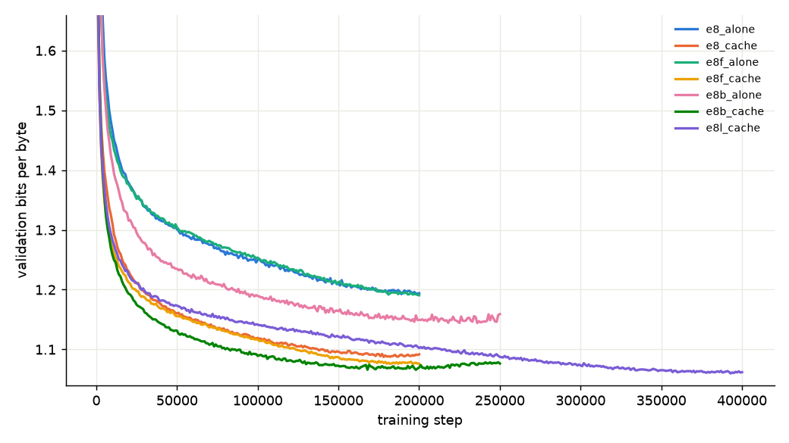
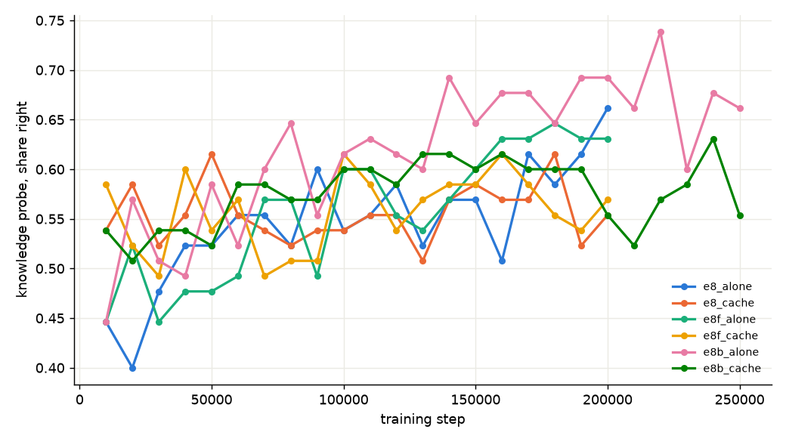
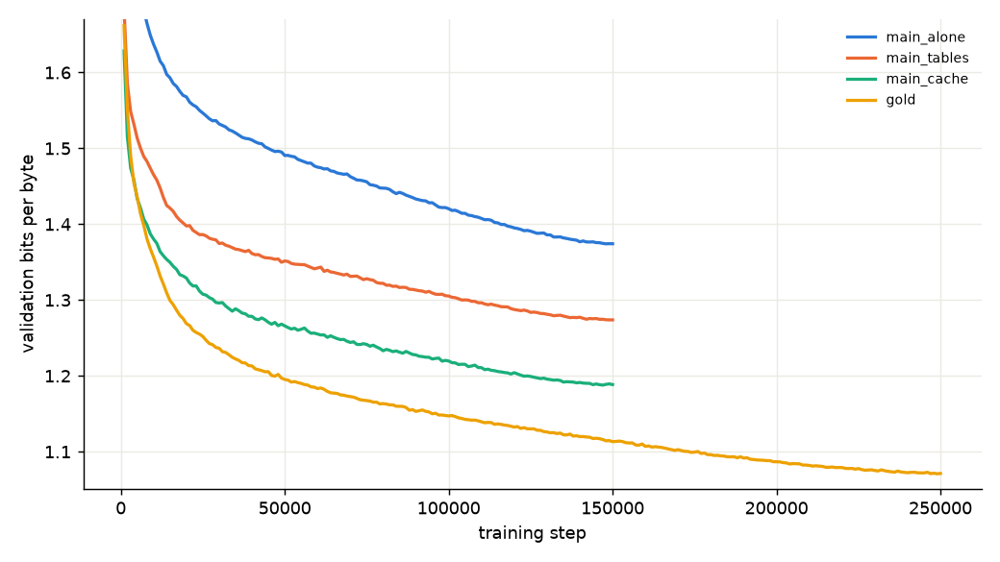
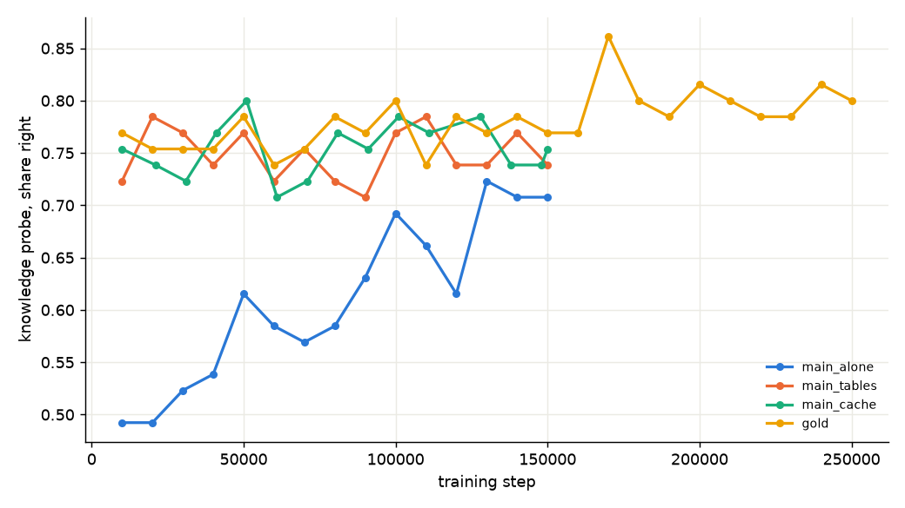
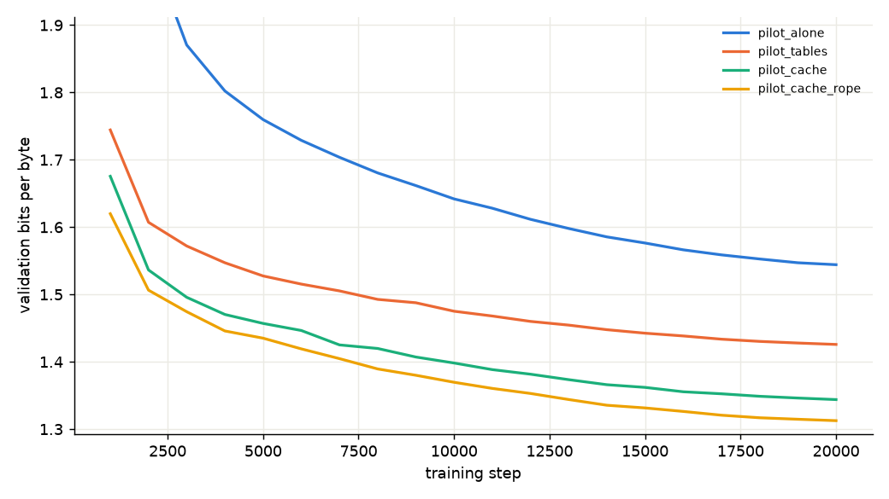
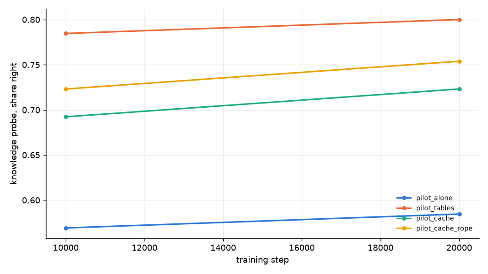

# Results

Updated 2026-11-17 02:22. Bits per byte, lower is better (1.20 bits per byte means the text can be stored in 15% of its size).

- **best val**: the score on 2,048 windows used during training to pick the best checkpoint.
- **val / test**: the best checkpoint on 20,480 windows (enwik8 runs: on every byte). The test text was never used for any choice.
- **warm**: only the second half of each window, where the transformer has context.
- **next byte right**: how often the most likely byte was the true one (test text, else val).
- **first letters**: bits per byte on first letters of words, where the next word is chosen.
- **probe**: share of the 65 knowledge questions answered right (4 choices, 25% is chance).

| run | status | memory | params (M) | ctx | rotary | steps | hours | best val | val | val warm | test | test warm | next byte right | first letters | probe |
|---|---|---|---|---|---|---|---|---|---|---|---|---|---|---|---|
| pilot_alone | finished | none | 25.6 | 256 | no | 20000 | 0.2 | 1.5442 | 1.5464 | 1.4764 | 1.5504 | 1.4795 |  |  | 58.5% |
| pilot_tables | finished | tables | 26.1 | 256 | no | 20000 | 0.2 | 1.4258 | 1.4286 | 1.4068 | 1.4429 | 1.4202 |  |  | 80.0% |
| pilot_cache | finished | tables + cache | 26.3 | 256 | no | 20000 | 0.3 | 1.3439 | 1.3462 | 1.3324 | 1.3557 | 1.3424 |  |  | 72.3% |
| pilot_cache_rope | finished | tables + cache | 26.1 | 256 | yes | 20000 | 0.3 | 1.3126 | 1.3157 | 1.2995 | 1.3251 | 1.3091 |  |  | 75.4% |
| main_alone | finished | none | 25.5 | 256 | yes | 150000 | 1.4 | 1.3741 | 1.3769 | 1.2949 | 1.3843 | 1.3010 | 70.8% | 3.6140 | 70.8% |
| main_tables | finished | tables | 26.0 | 256 | yes | 150000 | 1.8 | 1.2738 | 1.2765 | 1.2280 | 1.2904 | 1.2408 | 72.7% | 3.4810 | 72.3% |
| main_cache | finished | tables + cache | 26.1 | 256 | yes | 150000 | 2.4 | 1.1878 | 1.1910 | 1.1634 | 1.2011 | 1.1738 | 74.5% | 3.3722 | 75.4% |
| gold | finished | tables + cache | 86.4 | 1024 | yes | 250000 | 10.0 | 1.0709 | 1.0717 | 1.0521 | 1.0834 | 1.0625 | 77.0% | 3.1953 | 80.0% |
| e8_alone | finished | none | 38.1 | 512 | yes | 200000 | 2.9 | 1.1925 | 1.1200 | 1.1200 | 1.1036 | 1.1036 | 77.4% | 3.0365 | 60.0% |
| e8_cache | finished | tables + cache | 38.8 | 512 | yes | 200000 | 4.1 | 1.0874 | 1.0621 | 1.0621 | 1.0476 | 1.0476 | 78.4% | 2.9728 | 56.9% |
| e8f_alone | finished | none | 38.8 | 512 | yes | 200000 | 4.0 | 1.1906 | 1.1193 | 1.1193 | 1.1050 | 1.1050 | 77.5% | 3.0511 | 63.1% |
| e8f_cache | finished | tables + cache | 39.5 | 512 | yes | 200000 | 4.6 | 1.0760 | 1.0516 | 1.0516 | 1.0334 | 1.0334 | 78.7% | 2.9391 | 56.9% |
| e8b_alone | finished | none | 85.3 | 1024 | yes | 250000 | 8.3 | 1.1442 | 1.0917 | 1.0917 | 1.0750 | 1.0750 | 78.6% | 2.9936 | 69.2% |
| e8b_cache | finished | tables + cache | 86.3 | 1024 | yes | 250000 | 10.4 | 1.0659 | 1.0463 | 1.0463 | 1.0270 | 1.0270 | 79.0% | 2.9332 | 56.9% |
| e8l_cache | finished | tables + cache | 39.5 | 512 | yes | 400000 | 9.0 | 1.0598 | 1.0350 | 1.0350 | 1.0176 | 1.0175 | 79.0% | 2.9140 |  |

## enwik8: published test results for comparison

Bits per byte on the same 5 MB test file: Transformer, 12 layers, 41M parameters: 1.11 (Al-Rfou et al. 2018). Transformer-XL, 12 layers, 41M: 1.06; 18 layers, 88M: 1.03; 24 layers, 277M: 0.99 (Dai et al. 2019). mLSTM with dynamic evaluation, 46M: 1.08. The e8 runs here use count tables and a document cache on top of their parameters, so they belong with the results that use extra memory or adapt at test time, and the table size has to be reported next to the parameter count.

## Learning while reading (dynamic evaluation)

Test text, every byte. After each window is scored the model takes one small training step on it, so it only ever learns from text it has already been scored on. Published results of this kind: Transformer-XL 277M with dynamic evaluation 0.94 on enwik8.

| model | test | test, learning while reading | gain | step size |
|---|---|---|---|---|
| e8b_cache | 1.0270 | 0.9756 | 0.0513 | rms 5e-06 |
| e8b_alone | 1.0750 | 0.9990 | 0.0760 | rms 1e-05 |
| e8l_cache | 1.0176 | 0.9795 | 0.0380 | rms 1e-05 |

## Tables alone, document cache, leave-one-out check

```
  ngram_o2    val BPC 3.0554
  ngram       val BPC 1.9107   <- main
  ngram_long  val BPC 1.6275
  word        val BPC 1.8702
  cache       val BPC 3.2622
  ngram_long blended with 10% cache: val BPC 1.5371  (-0.0904)
  ngram_long blended with 20% cache: val BPC 1.5472  (-0.0803)
  ngram_long blended with 30% cache: val BPC 1.5805  (-0.0470)
leave-one-out check (bits per byte of each expert):
                                        ngram_o2       ngram  ngram_long        word       cache
  validation text                         3.0554      1.9107      1.6275      1.8702      3.2622
  counted text, own byte left out         3.0532      1.8979      1.6079      1.8586      3.2690
    minus validation                     -0.0022     -0.0128     -0.0196     -0.0116     +0.0068
  knowledge probe, tables alone: 72.3% of 65 right
```

## enwik8: tables alone

```
  ngram_o2    val BPC 3.1156
  ngram       val BPC 2.0072   <- main
  ngram_long  val BPC 1.8792
  word        val BPC 2.1565
  cache       val BPC 3.2125
  ngram_long blended with 10% cache: val BPC 1.6651  (-0.2141)
  ngram_long blended with 20% cache: val BPC 1.6462  (-0.2330)
  ngram_long blended with 30% cache: val BPC 1.6580  (-0.2212)
leave-one-out check (bits per byte of each expert):
                                        ngram_o2       ngram  ngram_long        word       cache
  validation text                         3.1156      2.0072      1.8792      2.1565      3.2125
  counted text, own byte left out         3.1055      1.8814      1.6816      2.0284      3.2635
    minus validation                     -0.0102     -0.1258     -0.1976     -0.1281     +0.0509
  knowledge probe, tables alone: 50.8% of 65 right
```

## Decisions

Rotary positions for the long runs: yes (pilot: learned positions 1.3462, rotary 1.3157).

## Time

- pilot_alone: 0.029 s per step, so 150,000 steps of the main size take about 1.2 h.
- pilot_tables: 0.040 s per step, so 150,000 steps of the main size take about 1.7 h.
- pilot_cache: 0.047 s per step, so 150,000 steps of the main size take about 2.0 h.
- pilot_cache_rope: 0.051 s per step, so 150,000 steps of the main size take about 2.1 h.

## Curves








## Sample texts and probe (best checkpoint of each finished run)

### pilot_alone

```
step 20000 = best model, final | val BPC 1.5442 ===
probe: 58.5% of 65 right; wrong: 'The capital of France is' -> ' Rome.' | 'The capital of Germany is' -> ' London.' | 'Mount Everest is in the' -> ' Alps.' | 'The Sahara is a very large' -> ' forest.' | 'The Amazon rainforest is in South' -> ' Africa.' | 'The chemical formula for water is' -> ' CO2.' | 'The planet closest to the Sun is' -> ' Jupiter.' | 'The heart pumps' -> ' water.' | 'Light travels much faster than' -> ' water.' | ' nucleus of an atom contains protons and' -> ' photons.' | 'There are twelve months in a' -> ' day.' | 'Half of one hundred is' -> ' thirty.'
--- 'The capital of France is'
The capital of France is accusation of the Jewels. Jewel refers to the results as the profile of being a restricted use of the Chapter 1 of the Jewels in a firmware (Red Judgement) and
--- 'Once upon a time, there was a little'
Once upon a time, there was a little cauliflower, a lot of patterns with a mold over night or so as to the capture. Do that doesn't mean that it's for some time to do that the bird.
When we go you
--- 'The main causes of the First World War were'
The main causes of the First World War were recommended to ensure the problem of lifestyle change. They were the most active problems of genetic diversity, and the problem of affecting the consequences o
--- 'Photosynthesis is the process by which'
Photosynthesis is the process by which the researchers and appliances are still needed. A triplex pulser can develop a photosynthesis that is interpreted only in the value of the limits. This can be
--- 'To make a cup of tea, first'
To make a cup of tea, first, and at least 6 percent.
These are four amazing procedures because they don’t have to be performed once they are making. First, the process of performing an 
--- 'In mathematics, a prime number is'
In mathematics, a prime number is most vulnerable to citizens. Its prime numbers are also very intense. In the prime nation of the city were the Children's Hospital (CHH), while a National Hosp
--- 'The teacher asked the students to'
The teacher asked the students to implement their behaviour in their respective procedures. "The responsibility to see master's efforts is often being directed and integrated into the behaviour
--- 'Question: Why is the sky blue?\nAnswer:'
Question: Why is the sky blue?
Answer: How does a mission to try to learn?
List of Radar Remover Slides
Version 3 - Instantaneous Engineering Activities and List of Radar Slide blue down the rotatio
```

### pilot_tables

```
step 20000 = best model, final | val BPC 1.4258 ===
probe: 80.0% of 65 right; wrong: 'The capital of France is' -> ' Rome.' | 'The capital of Germany is' -> ' London.' | 'Mount Everest is in the' -> ' Andes.' | 'The Sahara is a very large' -> ' forest.' | 'The planet closest to the Sun is' -> ' Neptune.' | 'Light travels much faster than' -> ' water.' | 'The Moon orbits the' -> ' Sun.' | 'Ten times ten equals one' -> ' million.' | 'Half of one hundred is' -> ' thirty.' | 'The past tense of run is' -> ' running.' | 'A year has four' -> ' weeks.' | 'To write on paper, you can use a' -> ' shoe.'
--- 'The capital of France is'
The capital of France is accusative of the Jewels. It has been suggested that the report found that great Jesuit destinations are given as follows: Questions from the Jewish people and
--- 'Once upon a time, there was a little'
Once upon a time, there was a little caution because of the small streams of limiting its most assumed that all of the three souls could be exposed to real name was Kotsaki, a biologist at St. Pet
--- 'The main causes of the First World War were'
The main causes of the First World War were released in the form of a pioneer research in climate and processes. The partnership has been effective prophylactic act setting where simply is constituting t
--- 'Photosynthesis is the process by which'
Photosynthesis is the process by which cloud based changes will also be respected. Both respondents are seeking to be taken back. The intervening clouds that start to the year in which they are bein
--- 'To make a cup of tea, first'
To make a cup of tea, first, and missed call the parents at the participants to construct protective values for the trip wire and to occupant health and the environment for their products
--- 'In mathematics, a prime number is'
In mathematics, a prime number is mounted onto a plate of frontotemporal Disorder. In your point of view, the first full value received from the Crittenden Nevado pers.
For a full path around t
--- 'The teacher asked the students to'
The teacher asked the students to improve participation from Afrikaans to Point Defects (see Day 1995), News 29.9 (40), Osaki.com (80), Nev. (by Newsroom); the additional power from the markets
--- 'Question: Why is the sky blue?\nAnswer:'
Question: Why is the sky blue?
Answer: How does a historic or biological or medical advice with the proper biological system should give you the major world religions that engineer or special way, c
```

### pilot_cache

```
step 20000 = best model, final | val BPC 1.3439 ===
probe: 72.3% of 65 right; wrong: 'The capital of Germany is' -> ' London.' | 'The largest ocean on Earth is the' -> ' Atlantic Ocean.' | 'Mount Everest is in the' -> ' Andes.' | 'The Sahara is a very large' -> ' glacier.' | 'Water is made of hydrogen and' -> ' helium.' | 'The planet closest to the Sun is' -> ' Jupiter.' | 'pulls objects toward the Earth is called' -> ' magnetism.' | 'Light travels much faster than' -> ' water.' | 'The Moon orbits the' -> ' Sun.' | 'Ten times ten equals one' -> ' million.' | 'Half of one hundred is' -> ' sixty.' | 'The opposite of hot is' -> ' fire.'
--- 'The capital of France is'
The capital of France is accusative case.
The evidence for a sustainable path is breakthrough to become an object of beauty in a support group. The lunar far side of the bridge is avai
--- 'Once upon a time, there was a little'
Once upon a time, there was a little country change for rewarding people with disabilities or societies, including equitable society and the air and water!
Law and Contemporary Experimental Academ
--- 'The main causes of the First World War were'
The main causes of the First World War were released in the course of the disease. As a result, “a special test score forced the wardens for a single personal photograph of a two-meter scale.”
News t
--- 'Photosynthesis is the process by which'
Photosynthesis is the process by which climate change is critical to get a little deeper than a single row. The digital pattern of other natural-gas-upgrading catalyst particles has caused a variety
--- 'To make a cup of tea, first'
To make a cup of tea, first, and it was called “Suevi,” to form a congregation at the project, develops a sort of precursor protein. That is how she was a woman: “Thanks for posting
--- 'In mathematics, a prime number is'
In mathematics, a prime number is mounted onto a plate of frontotemporal lobar degeneration. The old African American and Dominican Environmental Protection Agency, sending a permit.
Instead, d
--- 'The teacher asked the students to'
The teacher asked the students to identify the primary technique for recognition, and a healthy diet that is low in nitrogen.........
- This is called a pandemic bird when it is heated in a fle
--- 'Question: Why is the sky blue?\nAnswer:'
Question: Why is the sky blue?
Answer: How do scientists at the University?
Which states that the leadership of the Indiana Education Foundation (IPEF) was the first time in 20 years? What can the c
```

### pilot_cache_rope

```
step 20000 = best model, final | val BPC 1.3126 ===
probe: 75.4% of 65 right; wrong: 'The capital of Italy is' -> ' Athens.' | 'The capital of Germany is' -> ' London.' | 'The largest ocean on Earth is the' -> ' Atlantic Ocean.' | 'Mount Everest is in the' -> ' Andes.' | 'The Sahara is a very large' -> ' island.' | 'Water is made of hydrogen and' -> ' helium.' | 'pulls objects toward the Earth is called' -> ' magnetism.' | 'Light travels much faster than' -> ' water.' | 'At sea level, water boils at 100 degrees' -> ' Fahrenheit.' | 'The Moon orbits the' -> ' Sun.' | 'Ten times ten equals one' -> ' million.' | 'Half of one hundred is' -> ' thirty.'
--- 'The capital of France is'
The capital of France is accusative case.
This study reviews and science writer Seth Shostak, the Japanese campaign for "easy" analogous to the second instrument of his chain of indexe
--- 'Once upon a time, there was a little'
Once upon a time, there was a little cautious to an absorption band. And a mold is bonded in a reasonable amount of time any of the basic causes and the interaction between the interaction of a li
--- 'The main causes of the First World War were'
The main causes of the First World War were released in the form of depression, you can include “a special test score for a given text, engineering aspect of the psychic cost, which keeps track of the 
--- 'Photosynthesis is the process by which'
Photosynthesis is the process by which climate change is critical to the process by which transfer information about state level. The interval was conducted on a press protected from the information
--- 'To make a cup of tea, first'
To make a cup of tea, first, and at least 60 percent of a Saturday night greeting, and began to strengthen the natural period of one occasion. St. John’s wort has been used to make prot
--- 'In mathematics, a prime number is'
In mathematics, a prime number is mounted onto a plate of frontotemporal lobar degeneration. The old African-American and Dominican studies are coming out of the epidemic, which has been found 
--- 'The teacher asked the students to'
The teacher asked the students to identify the primary teaching financial literacy to advocate for the greater chance that these conditions may cause you. Edit your visual system identify and e
--- 'Question: Why is the sky blue?\nAnswer:'
Question: Why is the sky blue?
Answer: House is a historical context, because it is a specific challenge. You might discover some pressure or stress.
Download Figure 2: Discover the different ways a
```

### main_alone

```
step 148000 = best model, final | val BPC 1.3741 ===
probe: 70.8% of 65 right; wrong: 'The capital of Germany is' -> ' London.' | 'The largest ocean on Earth is the' -> ' Atlantic Ocean.' | 'The Sahara is a very large' -> ' island.' | 'The chemical formula for water is' -> ' CO2.' | 'The planet closest to the Sun is' -> ' Jupiter.' | 'Light travels much faster than' -> ' water.' | 'Two plus two equals' -> ' three.' | 'Ten times ten equals one' -> ' million.' | 'There are seven days in a' -> ' year.' | 'Half of one hundred is' -> ' forty.' | 'The opposite of up is' -> ' high.' | 'The past tense of run is' -> ' running.'
--- 'The capital of France is'
The capital of France is accusationded by the empire’s resistance to revolution as an insult to the capitalist democracy. The same is true of the luxuriant discontents in the America
--- 'Once upon a time, there was a little'
Once upon a time, there was a little cause. The National Museum of the American Revolution had a superb way of exploring and seeing the floresized forms in the archives of the Williamsburg State P
--- 'The main causes of the First World War were'
The main causes of the First World War were the implementation of the 2005 Aboriginal Agricultural and Social Affairs Act, called the "Aboriginal Aboriginal Agreement" and the first world war to take pla
--- 'Photosynthesis is the process by which'
Photosynthesis is the process by which clouds are expanding. This synthesis would depend on the sensory system and behavior of the clouds. If it’s uniformly shaped, then the sphere could be a bett
--- 'To make a cup of tea, first'
To make a cup of tea, first, and all organic products seal at the start. Mark a corner before making a cup of tea until the start of the day, and ask for cup of tin for a small amount of 
--- 'In mathematics, a prime number is'
In mathematics, a prime number is most valuable in their bodies as per whatever they are concerned with in the mathematical world, and there is no reason to believe that the mathematical world 
--- 'The teacher asked the students to'
The teacher asked the students to install a new type of surgical instruction in a place where the types of surgery to complete the type of surgical instruction are identified. The teacher could
--- 'Question: Why is the sky blue?\nAnswer:'
Question: Why is the sky blue?
Answer: How does a human sky change form? How did a human sky get into our sky? Why were it so cold? Could a human sky align the sky with our neighbors? What causes it
```

### main_tables

```
step 149000 = best model, final | val BPC 1.2738 ===
probe: 72.3% of 65 right; wrong: 'The capital of France is' -> ' Rome.' | 'The capital of Japan is' -> ' Beijing.' | 'The capital of Italy is' -> ' Paris.' | 'The capital of Germany is' -> ' London.' | 'The capital of the United Kingdom is' -> ' Paris.' | 'The largest ocean on Earth is the' -> ' Atlantic Ocean.' | 'Mount Everest is in the' -> ' Andes.' | 'The Sahara is a very large' -> ' island.' | 'Water is made of hydrogen and' -> ' helium.' | 'The planet closest to the Sun is' -> ' Jupiter.' | 'Light travels much faster than' -> ' water.' | 'Ten times ten equals one' -> ' million.'
--- 'The capital of France is'
The capital of France is accusative of the Jewels. It has been said that the practise of the words does not serve as an example of the words of the Qur’an. But it is despite the fact
--- 'Once upon a time, there was a little'
Once upon a time, there was a little caution between the curse and the curse, but it never took up any things. The scrotum was clearly a little baroque, and the word “the” was a strange scroll
--- 'The main causes of the First World War were'
The main causes of the First World War were the implantation of residents and residents in the first two categories of abuse. Although it ended the president’s copyright of an abuse press conference in
--- 'Photosynthesis is the process by which'
Photosynthesis is the process by which computer based methods are used to detect computer training courses. The digital pattern of computer science in the classroom is the most prominent in internet
--- 'To make a cup of tea, first'
To make a cup of tea, first, ask yourself what each entrance or person is. Second, at the prompt, do you assume that the cup is presently a sacrificial altar in the cup or a prompt local 
--- 'In mathematics, a prime number is'
In mathematics, a prime number is much lower, of all circumstances, than a prime number.
For example, the number of mutations in the Pu Period primer on the 1950s per unit was 18.3 million. The
--- 'The teacher asked the students to'
The teacher asked the students to investigate how behaviour influences the different factors of the instruction. They calculated how the simplified version of the instruction worked to express 
--- 'Question: Why is the sky blue?\nAnswer:'
Question: Why is the sky blue?
Answer: How does a highly accurate and precise image of a planet through Venus's atmosphere have found and acted in an atmosphere of impunity and believed the atmosphe
```

### main_cache

```
step 147000 = best model, final | val BPC 1.1878 ===
probe: 75.4% of 65 right; wrong: 'The capital of France is' -> ' Rome.' | 'The capital of Germany is' -> ' London.' | 'The capital of the United Kingdom is' -> ' Paris.' | 'The largest ocean on Earth is the' -> ' Atlantic Ocean.' | 'The Sahara is a very large' -> ' island.' | 'Water is made of hydrogen and' -> ' helium.' | 'The planet closest to the Sun is' -> ' Jupiter.' | 'Light travels much faster than' -> ' water.' | 'At sea level, water boils at 100 degrees' -> ' Fahrenheit.' | 'Ten times ten equals one' -> ' million.' | 'The opposite of up is' -> ' over.' | 'The past tense of run is' -> ' running.'
--- 'The capital of France is'
The capital of France is accusative of the Jewels. It has been said that the practise of franchisees, called micelles, is a practical operation for luxuries in which no single group of
--- 'Once upon a time, there was a little'
Once upon a time, there was a little caution before the reformation of the modern chondromatosis and the exclusion of the efforts that had been identified by that “others” in D. W. Whitehead�
--- 'The main causes of the First World War were'
The main causes of the First World War were formed in 1861 by the state of Abraham Lincoln as the first woman elected to the First World War. In 1872 the First World War served the memorial of the New Wo
--- 'Photosynthesis is the process by which'
Photosynthesis is the process by which the form below to compostable is respectively Vs = 104, while in the second book, it is equally true that the unit of the first two is a process called vs inte
--- 'To make a cup of tea, first'
To make a cup of tea, first, and most recently, a luminosity of periodically frozen tundra of the Tarot.
As a result, the Tarot process has been shown to cause a problem in the United Sta
--- 'In mathematics, a prime number is'
In mathematics, a prime number is most widely used in industry for prime time. It is an open question whether the organization receives some time in the tendency to learn and grow. Following th
--- 'The teacher asked the students to'
The teacher asked the students to identify the primary teaching methods they use, and a concept testing their skills in assessing their involvement. Their graceful skills provide education with
--- 'Question: Why is the sky blue?\nAnswer:'
Question: Why is the sky blue?
Answer: How does a historian name the sky over his sky spring to the prophets?
believe that a sky just as the sky over a sky is composed of a number of
flats, a way to
```

### gold

```
step 249000 = best model, final | val BPC 1.0709 ===
probe: 80.0% of 65 right; wrong: 'The largest ocean on Earth is the' -> ' Atlantic Ocean.' | 'The Sahara is a very large' -> ' island.' | 'The Eiffel Tower is in' -> ' Rome.' | 'Water is made of hydrogen and' -> ' helium.' | 'The planet closest to the Sun is' -> ' Jupiter.' | 'Light travels much faster than' -> ' water.' | 'At sea level, water boils at 100 degrees' -> ' Fahrenheit.' | 'Ten times ten equals one' -> ' million.' | 'Half of one hundred is' -> ' forty.' | 'The opposite of hot is' -> ' heat.' | 'The past tense of run is' -> ' running.' | 'A year has four' -> ' months.'
--- 'The capital of France is'
The capital of France is accused of being culturally relevant as of not condemning something which is called military prejudice. The conjugal act of "eight hundred and seventeen is a r
--- 'Once upon a time, there was a little'
Once upon a time, there was a little caution at the time. I started to have them visit the monuments later this year, but then I came to the article with a new answer to the question: "What happen
--- 'The main causes of the First World War were'
The main causes of the First World War were the implementation of the prohibition of suicides (for example, chemical parameters in which suicidal impulses were exclusively considered) and occurrence of t
--- 'Photosynthesis is the process by which'
Photosynthesis is the process by which cells make energy. Humans have been learning of the process in recent years by taking a very large amount of energy to start their diet. If life came from a pl
--- 'To make a cup of tea, first'
To make a cup of tea, first print the recipe item, using a cup of hot chocolate, change the original values and reuse the numbers to the nearest host. Paint the values of the recipe on th
--- 'In mathematics, a prime number is'
In mathematics, a prime number is a prime number in two different dimensions. Let’s say that f is a finite number of dimensions, and the f is a x times m times m, so that f is a finite number
--- 'The teacher asked the students to'
The teacher asked the students to identify the primary function of the compound phase and determine its relative composition. The students were to assign an introductory material to the phase s
--- 'Question: Why is the sky blue?\nAnswer:'
Question: Why is the sky blue?
Answer: How does a high station stretch from the sky and blur the sun?
Answer: A high station stretches from the sun to the sky.
What is the difference between a three
```

### e8_alone

```
step 189000 = best model, final | val BPC 1.1925 ===
probe: 60.0% of 65 right; wrong: 'The capital of Japan is' -> ' Beijing.' | 'The largest ocean on Earth is the' -> ' Atlantic Ocean.' | 'Mount Everest is in the' -> ' Andes.' | 'The Sahara is a very large' -> ' forest.' | 'The chemical formula for water is' -> ' CO2.' | ' their own food through a process called' -> ' evaporation.' | 'The planet closest to the Sun is' -> ' Jupiter.' | 'The heart pumps' -> ' air.' | 'The basic unit of life is the' -> ' atom.' | 'Light travels much faster than' -> ' water.' | 'The Moon orbits the' -> ' Sun.' | 'Ten times ten equals one' -> ' million.'
--- 'The capital of France is'
The capital of France is [[Lisbon]].

There is a large [[collection (philosophy)|collection]] of buildings of members of the main group known as the [[Member of Parliament]] in France.
--- 'Once upon a time, there was a little'
Once upon a time, there was a little caution for an [[Abraham]]ic people who left then to set up a prophetic discipleship.  Books that had been identified with a counterfactual setting were given 
--- 'The main causes of the First World War were'
The main causes of the First World War were the importance of the [[German Empire]] as the composer of the ''[[German Language]]'' which generally belonged to a particular cultural movement (see the sect
--- 'Photosynthesis is the process by which'
Photosynthesis is the process by which the remaining carbon atoms are bonded to. The metal atoms are actually [[electron]]s with the constituents of their constituents.

The carbon atoms in the bond
--- 'To make a cup of tea, first'
To make a cup of tea, first, and second, all people ever work to the main crest of any burial master or sacred order.  After the recovery of a master from a main crest of any burial maste
--- 'In mathematics, a prime number is'
In mathematics, a prime number is called a [[decimal]].

In order to represent the integers, the [[width function]] for a computer can be represented by the following [[axiom of choice]]:

 axi
--- 'The teacher asked the students to'
The teacher asked the students to take care of him the first Afrikaans teachers and commissioned him to record his own master. He was to be made a strong and cultural assistant at the [[Univers
--- 'Question: Why is the sky blue?\nAnswer:'
Question: Why is the sky blue?
Answer:''
*''You are sky blue with a large thing and a space!''
*''I'm called you're sky blue sky.''

===Final starting picture films===
{{main|Final starting picture
```

### e8_cache

```
step 178000 = best model, final | val BPC 1.0874 ===
probe: 56.9% of 65 right; wrong: 'The largest ocean on Earth is the' -> ' Atlantic Ocean.' | 'Mount Everest is in the' -> ' Alps.' | 'The Sahara is a very large' -> ' island.' | 'The chemical formula for water is' -> ' CO2.' | ' their own food through a process called' -> ' respiration.' | 'The planet closest to the Sun is' -> ' Jupiter.' | 'The heart pumps' -> ' water.' | 'Ice is the solid form of' -> ' metal.' | 'Light travels much faster than' -> ' water.' | 'At sea level, water boils at 100 degrees' -> ' Fahrenheit.' | 'The Moon orbits the' -> ' Sun.' | 'Two plus two equals' -> ' three.'
--- 'The capital of France is'
The capital of France is [[Francisco Tárrega|Tárrega]] (Royaume-Uni), and it was so named after the capital it was built in [[1555]] with [[María Berga]] (Bavarian designation).

Th
--- 'Once upon a time, there was a little'
Once upon a time, there was a little caution from the Time of the New World. In October 1996 the [[United States]] passed a reform change within the [[United Nations]]. In the [[United Kingdom]], 
--- 'The main causes of the First World War were'
The main causes of the First World War were the implacable effect that soon began.  The influx of technological superiority and hunting of first wooden plates and fronts such as walls and doors could be 
--- 'Photosynthesis is the process by which'
Photosynthesis is the process by which computers work together tasks about certain models that work on real-life, database and dynamic systems. It is important to note that computers can be integrat
--- 'To make a cup of tea, first'
To make a cup of tea, first or second receptive and eventually forming cages to cover the production of sand tons until the first receptive and sharing are later introduced.

The problem 
--- 'In mathematics, a prime number is'
In mathematics, a prime number is called an [[endothermic reaction]].  In imaginary [[continuous function (topology)|continuous functions]], the continuous function &lt;math&gt;g_i = lb&lt;/mat
--- 'The teacher asked the students to'
The teacher asked the students to impress him out by studying at the restaurant in Columbia, UK.  He was disturbed by these impresses, and on a considerable thuriation she said &quot;I have gon
--- 'Question: Why is the sky blue?\nAnswer:'
Question: Why is the sky blue?
Answer: How down a hill?
Father: Runforget?
Litigation: Abildgaard like a louvre and dishonesty of pursuit:
Streat a lion and a piercing booby.
I believe that the name
```

### e8f_alone

```
step 200000 = best model, final | val BPC 1.1906 ===
probe: 63.1% of 65 right; wrong: 'The largest ocean on Earth is the' -> ' Atlantic Ocean.' | 'Mount Everest is in the' -> ' Alps.' | 'The Sahara is a very large' -> ' forest.' | 'The chemical formula for water is' -> ' CO2.' | ' their own food through a process called' -> ' fermentation.' | 'The planet closest to the Sun is' -> ' Jupiter.' | 'The heart pumps' -> ' water.' | 'Light travels much faster than' -> ' water.' | 'Two plus two equals' -> ' six.' | 'Ten times ten equals one' -> ' million.' | 'There are seven days in a' -> ' year.' | 'Half of one hundred is' -> ' thirty.'
--- 'The capital of France is'
The capital of France is [[Lilandre]].

The largest city in France is [[Basel]] ([[south France]]), located in the southern part of the country. The city's first [[airport]] is [[Basel
--- 'Once upon a time, there was a little'
Once upon a time, there was a little caution that the Time Lords would have to make any further safety than any of the three of the three cases.

The Great Leaf Time Lords consisted of 16 county c
--- 'The main causes of the First World War were'
The main causes of the First World War were [[weapons of mass destruction]] and the rise of [[defense (military)|defense]] campaigns. The effect of pressure on the political community at the English Civi
--- 'Photosynthesis is the process by which'
Photosynthesis is the process by which the formation of a material can be driven by one reduction pulse. The difficulty in determining the outcome of this construction is that the differential equat
--- 'To make a cup of tea, first'
To make a cup of tea, first, and foremost the team mention a new team in the same roll.  

====Examples====
After the regular season, the team makes a new roll.  If the team crosses on th
--- 'In mathematics, a prime number is'
In mathematics, a prime number is counted as a field with its total number ''a'' and the dimension with its [[number (topology)|number]]s, its [[continuous functor]] ''f'' with the addition and
--- 'The teacher asked the students to'
The teacher asked the students to take account of their subjectivity and and is prescribed by a fellowship in [[Hanover]]. 

This program is now ready to be replaced by a principal teacher whos
--- 'Question: Why is the sky blue?\nAnswer:'
Question: Why is the sky blue?
Answer: How does the sky satisfy the laws of the universe?
Switch to the Vedic beliefs?

If we collect and add a separate list of laws to our universe,
then we collect
```

### e8f_cache

```
step 200000 = best model, final | val BPC 1.0760 ===
probe: 56.9% of 65 right; wrong: 'The capital of Italy is' -> ' Paris.' | 'The largest ocean on Earth is the' -> ' Atlantic Ocean.' | 'Mount Everest is in the' -> ' Rockies.' | 'The Sahara is a very large' -> ' island.' | 'The chemical formula for water is' -> ' CO2.' | ' their own food through a process called' -> ' fermentation.' | 'The planet closest to the Sun is' -> ' Jupiter.' | 'Light travels much faster than' -> ' water.' | 'At sea level, water boils at 100 degrees' -> ' Fahrenheit.' | 'The Moon orbits the' -> ' Sun.' | 'Two plus two equals' -> ' three.' | 'There are seven days in a' -> ' year.'
--- 'The capital of France is'
The capital of France is actually France.

==Geography==
[[Image:France - Editoré Coat of Arms.png|thumb|right|France in France]]
:''Main article: [[Geography of France]]''

The coast
--- 'Once upon a time, there was a little'
Once upon a time, there was a little cause of death for the small peoples of the victims and consequently the high profile of foreign policy. At the time, they were almost unlike the Soviet Union 
--- 'The main causes of the First World War were'
The main causes of the First World War were the implementation of the protocols of the &quot;[[First Council of Nicaea]]&quot;, which was effectively approved as copies in Copenhagen and other cities. Th
--- 'Photosynthesis is the process by which'
Photosynthesis is the process by which computer games are mapped into a respective software that allows users to write a detailed format of a game (or other format that can be processed to any other
--- 'To make a cup of tea, first'
To make a cup of tea, first, and first: 
:::''tea''... the angel of death... the crater of roads... the same thing... the crater of world roads.&quot; 
:::''Crater of the angel of death. 
--- 'In mathematics, a prime number is'
In mathematics, a prime number is said to be '''equivalent''' to the number of sets of positive numbers (see below).

The concept of the [[integral of term functor]] is also the most widely acc
--- 'The teacher asked the students to'
The teacher asked the students to insert a traveling student into a Crowser's Dilemma at the end of a street on the end of the student's birthday.  As the student hits all of the student's work
--- 'Question: Why is the sky blue?\nAnswer:'
Question: Why is the sky blue?
Answer: How does a human skeleton be left over?

===Radical reasons===

In the book &quot;[[Positron: Last Investigations]]&quot;, Gaius Julius Caesar describes whethe
```

### e8b_alone

```
step 236000 = best model, final | val BPC 1.1442 ===
probe: 69.2% of 65 right; wrong: 'The capital of Italy is' -> ' Paris.' | 'The largest ocean on Earth is the' -> ' Atlantic Ocean.' | 'Mount Everest is in the' -> ' Alps.' | 'The Sahara is a very large' -> ' island.' | 'The Eiffel Tower is in' -> ' Rome.' | 'The chemical formula for water is' -> ' CO2.' | 'The planet closest to the Sun is' -> ' Jupiter.' | 'The heart pumps' -> ' air.' | 'Light travels much faster than' -> ' water.' | 'Two plus two equals' -> ' three.' | 'There are seven days in a' -> ' year.' | 'A square has four equal' -> ' colors.'
--- 'The capital of France is'
The capital of France is [[Munich]].

==Towns==
France has one of the largest towns of the [[Netherlands]]: [[Belfast]] (''Verfassung''), which is located in the [[Netherlands]]; [[Ber
--- 'Once upon a time, there was a little'
Once upon a time, there was a little country where strong was able to restore the chance of surrendering in a hand. During this time Once Upon and Upon the Law and Constitution of the [[National A
--- 'The main causes of the First World War were'
The main causes of the First World War were [[war economy|war]], [[industry]], [[politics]] and [[capital punishment]]. Some of these economies contributed to a revival in the former [[Soviet Union]]. Th
--- 'Photosynthesis is the process by which'
Photosynthesis is the process by which complex materials can be adapted to leave behind a state of uniformity between the lower parts of the state and the constant extension of the surface, increasi
--- 'To make a cup of tea, first'
To make a cup of tea, first, and second, all people engage in [[pedestrianism|pedestrian]] rituals, even as a sort of pedestrian ritual. 

The [[sanitation]] of the cup of a crow is often
--- 'In mathematics, a prime number is'
In mathematics, a prime number is counted as a field with no negative number. However, in the language of [[algebraic geometry]] (see [[symbolic geometry]] and [[spectral analysis]]), the argum
--- 'The teacher asked the students to'
The teacher asked the students to take a space prior to the search. As a result, Bacon requested that he do not publish any information on [[paper]]. &lt;ref&gt; [http://www.learningtoday.com/W
--- 'Question: Why is the sky blue?\nAnswer:'
Question: Why is the sky blue?
Answer: &quot;Q&quot;

To avoid seeing the thing &quot;space&quot; in the context of discourse, see [[darkness]].  For alternative meanings see [[blue darkness#See als
```

### e8b_cache

```
step 198000 = best model, final | val BPC 1.0659 ===
probe: 56.9% of 65 right; wrong: 'The capital of Japan is' -> ' Beijing.' | 'The capital of Italy is' -> ' Athens.' | 'The largest ocean on Earth is the' -> ' Atlantic Ocean.' | 'Mount Everest is in the' -> ' Andes.' | 'The Sahara is a very large' -> ' island.' | 'The chemical formula for water is' -> ' CO2.' | ' their own food through a process called' -> ' fermentation.' | 'The planet closest to the Sun is' -> ' Jupiter.' | 'The heart pumps' -> ' water.' | 'Ice is the solid form of' -> ' metal.' | 'The basic unit of life is the' -> ' atom.' | 'Light travels much faster than' -> ' water.'
--- 'The capital of France is'
The capital of France is accorded the leading elevation, reaching 341 meters (103 feet). However, there are several units a year and a half later that are required to be integrated as 
--- 'Once upon a time, there was a little'
Once upon a time, there was a little caution as to whether the backbone was the same nor whether a propeller could be reused or burnt.  Also, it was thought that the others could be stopped and lo
--- 'The main causes of the First World War were'
The main causes of the First World War were the importance of the strategems of the [[Soviet Union]] and the [[Soviet Union]] to ensure their success in controlling soviet control in the [[countries of t
--- 'Photosynthesis is the process by which'
Photosynthesis is the process by which complex metabolic processes can be detected by synthesizing poisons. The distinction between these two interactions can be presented in the form of interaction
--- 'To make a cup of tea, first'
To make a cup of tea, first, a cart may check the wood of the tea, then remain cup at the point of departure for the traditional recipe.  The cart is fitted in a similar manner to a cup o
--- 'In mathematics, a prime number is'
In mathematics, a prime number is called an '''entire inverse''', i.e. we can start with ''any'' inverse in a number ''n'' and receive ''n'' &lt; 0.

Executive does not apply to any [[factorial
--- 'The teacher asked the students to'
The teacher asked the students to institute a full school of Art in California in 1900 to deal with a sociological strata. His method was investigated by the current Federal State Statistical C
--- 'Question: Why is the sky blue?\nAnswer:'
Question: Why is the sky blue?
Answer: How does a hollow sky work after a thinner sky should that look like it?

[[Category:Astrological signs]]
[[Category:Extraterrestrial life]]
[[de:Extension (St
```
